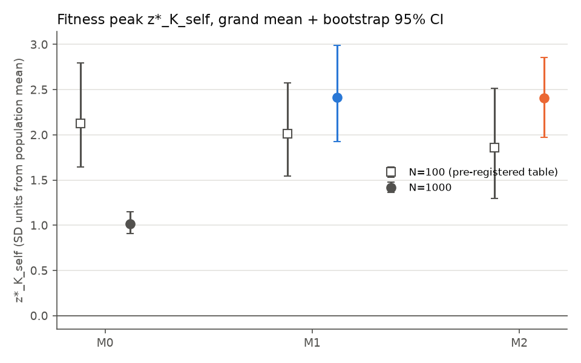
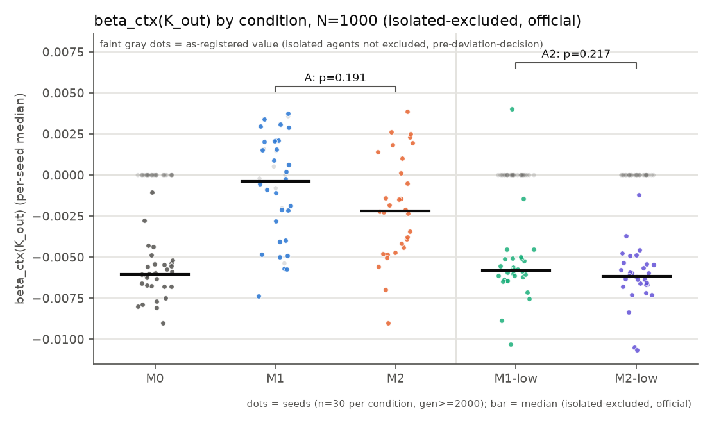
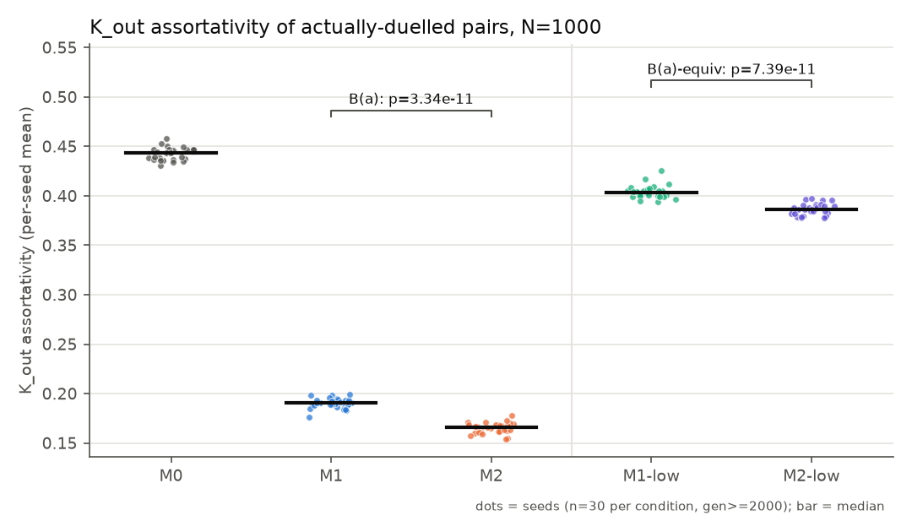

# 第三章 N=1000再現実験: 本番解析結果

事前登録: `docs/PREREGISTRATION_scent_model_N1000.md`(以下「事前登録」)。
解析スクリプト: `scripts/analyze_scent_production_n1000.py`(数値の全出力は
`scripts/output/scent_spatial_sweep_n1000/analysis/results.json`、図は `docs/figures/scent_n1000/`)。

本文は事前登録の記載順(0節 → 3節 第2群 → 5節 浮動 → 6節 第1群)で並べ、各項目に
**【主要】【副次】【記述(事前登録済み)】【探索的・事前登録外】** のラベルを付けた。
事前登録の方針どおり、解釈は加えず、データが示す形の記述にとどめる。

共通の定義(100個体版の `scripts/analyze_scent_production.py` と同一):

- 定常状態: gen>=2000。個体ログは100世代ごと(1シードあたり30世代分)。
- β系の係数: 各世代で回帰 → シード内中央値 → 条件内n=30。
- 似かた(K_out assortativity)などの操作指標: timeseries.csvのシード内平均(gen>=2000)。
  検定はシード内平均をそのまま使う。B(b)のx0は「シード内平均」の条件内中央値。
- Mann-Whitney Uは両側。効果量 r = 1 − 2U/(n1·n2)。U は「先に書いた条件」(M2, M2-low)について計算しているので、
  **r>0 は先に書いた条件の値が小さい方向**。100個体版と同じ符号の向き。
- N=1000の生の個体ログ(`*_individual_log.csv.gz`)は実行マシンにしか無い。β系の係数・z*・分散・二峰性は、
  実行中に同じ計算式で求めてコミットされた `seed_X_summary.csv` から読んだ。

---

## ⚠ 最初に: β_ctx が「ちょうど0」になる計算上の問題(報告が必要な事実)

事前登録で固定された文脈回帰(`context_lande_arnold`)は、その世代に**1回も対戦しなかった個体(孤立個体)**が
1体でもいると、文脈係数 β_ctx(K_out)・β_ctx(K_self) がどちらも**ちょうど0**を返す。
仕組み: 孤立個体の `opponent_mean_k_*` は NaN → 列の `np.std` が NaN → `NaN > 0` が偽になる →
`standardize()` が列を全部0にする → 最小ノルム解でその係数が0になる。100個体版・1000個体版でまったく同じコードを使っている。

timeseries.csv の `isolated_fraction`(全世代について記録されている)から、該当する世代(gen>=2000、100世代ごと)を数えると:

| 条件 | 孤立個体がいて β_ctx=0 にされた世代 | 割合 | 過半数の世代が0になったシード |
|---|---|---|---|
| M0 | 819 / 900 | 91.0% | 30 / 30 |
| M1 | 22 / 900 | 2.4% | 0 / 30 |
| M2 | 2 / 900 | 0.2% | 0 / 30 |
| M1-low | 836 / 900 | 92.9% | 30 / 30 |
| M2-low | 748 / 900 | 83.1% | 30 / 30 |
| (参考)100個体版 M0 | 286 / 1500 | 19.1% | — |
| (参考)100個体版 M1・M2 | 0 / 1500 | 0% | — |

このため **M0・M1-low・M2-low では、全30シードのシード内中央値 β_ctx(K_out) がちょうど 0.000000** になっている。
1000個体では孤立個体の期待数が1世代あたり約2〜3体(孤立割合 約0.2〜0.26% × 1000体)になり、ほぼすべての世代が該当する。
100個体版では期待数が約0.2体なので、M0の約19%の世代だけが該当し、中央値は0にならなかった。

影響範囲:
- **第2群の主要評価A2は、事前登録どおりの計算では評価できない**(60値すべてが0で、検定統計量が定義できない)。
- 第1群のB(b)のM0、第2群のB(b)相当、B(c)のM0の β_ctx(K_out) も同じ理由で0になっている。
- 第1群の主要評価A(M2 vs M1)では、該当する世代は M1 が2.4%・M2 が0.2% にとどまる。
  シード内中央値への影響は小さいが、ゼロではない。
- 自分の形質だけのLande-Arnold係数・z*・分散・二峰性・操作指標は、相手の値を使わないので影響を受けない。
  β_self(K_*)(文脈回帰の自己項)は、該当する世代では文脈項を抜いた回帰の値になっている。

**2026-10-14 更新:** `docs/DEVIATION_isolated_agents.md` で、孤立個体はその世代の文脈回帰から除外した版
(以下「孤立除外版」)を主要検定A・A2の**正式な値**とすることが、N=1000の孤立除外版の結果を見る前に決定された。
N=1000の生ログ(`*_individual_log.csv.gz`、150ファイル)がブランチ `claude/inspiring-allen-ja4ele` から届いたため、
孤立除外版を100個体版・1000個体版の両方で計算した(本文3節・6節・D節・E1節)。
事前登録どおりの計算(孤立個体を除外しない版、以下「事前登録版」)も、判断材料として並べて記載する。
図1・図3は孤立除外版を正式な値として描き直し、事前登録版は薄い色の点で重ねた(図2・図4は変更なし)。

---

## 0節. パイロットと本番の分離

- 読み込んだのは本番の5ディレクトリだけ(`none`, `random`, `scent`, `random_low`, `scent_low` の各
  `doeRyanoMacBook-Neo.local/`)。どれも 30/30 シード、5000世代分の timeseries と summary がそろっている。
- `*_pilot*` ディレクトリはスクリプト内で一度も参照しない。パイロットから本番に渡ったのは、
  tau=0.033333、M1のp_move=0.501262、M1-lowのp_move=0.486950 の3つの数値だけ
  (`docs/SCENT_MODEL_N1000_CALIBRATION_DECISION.md`)。
- 品質チェック: どの条件も全シードで有効世代数は30(n_qualifying_gens=30)。
- 記録上の注意: M1・M1-low の `run_metadata.json` はコミットされていない(後述の不具合(b)の痕跡)。
  条件の設定値は、上記の決定記録とパイプラインのログに残っている。

---

## 3節. 第2群(M1-low vs M2-low)

### A2. β_ctx(K_out)、M2-low vs M1-low【主要・確証的】

**正式な値(孤立除外版、`docs/DEVIATION_isolated_agents.md` 決定2):**

| | M2-low | M1-low |
|---|---|---|
| β_ctx(K_out) 中央値 | −0.006158 | −0.005825 |

U=366.0, **p=0.2170**, r=+0.187(n.s.)。

参考・事前登録どおりの計算(孤立個体を除外しない版):

| | M2-low | M1-low |
|---|---|---|
| β_ctx(K_out) 中央値 | 0.000000 | 0.000000 |

U=450.0(= 30·30/2)、p=1.0(全60値が同じ値になるため、冒頭の計算上の問題で事実上評価できない)。

### B(a)相当. K_out似かた、M2-low vs M1-low【副次】

| | M2-low | M1-low |
|---|---|---|
| 中央値 | 0.386090 | 0.403532 |

U=9.0, p=7.39×10⁻¹¹, r=+0.980(***、M2-low < M1-low)。

事前登録3節の予測「M2-lowの似かたはM1-lowより明確に低くなる」と同じ向き。

### B(b)相当. 環状モデル予測区間のチェック【副次】

y_hat(x) = −0.00016799 − 0.00719578·x、95%予測区間は事前登録の式どおり。

| 条件 | 観測 x0(似かた) | 観測 β_ctx(K_out) | 予測 y_hat | 95%予測区間 | 区間内? |
|---|---|---|---|---|---|
| M1-low | 0.403532 | +0.000000* | −0.003072 | [−0.005108, −0.001036] | NO |
| M2-low | 0.386090 | +0.000000* | −0.002946 | [−0.005006, −0.000886] | NO |

\* 冒頭の計算上の問題により0になった値。
事前登録で論理的に導かれていた「β_ctx(K_out)の予測値はM2-lowの方が0に近い」は、予測値どうしの比較では成り立っている
(−0.002946 > −0.003072)。観測値どうしの比較は、両方が0のためできない。

### 移動頻度の効果(M2 vs M2-low、参考に M1 vs M1-low)【記述(事前登録済み)・検定なし】

シード中央値 [IQR]:

| 指標 | M2 | M2-low | M1 | M1-low |
|---|---|---|---|---|
| K_out似かた | 0.1655 [0.1613, 0.1686] | 0.3861 [0.3821, 0.3896] | 0.1905 [0.1883, 0.1930] | 0.4035 [0.4001, 0.4055] |
| β_ctx(K_out) | −0.002170 [−0.004355, +0.000803] | 0.000000* [0, 0] | −0.000099 [−0.003699, +0.001925] | 0.000000* [0, 0] |
| 移動率 | 0.5341 [0.5251, 0.5451] | 0.0501 [0.0497, 0.0505] | 0.4820 [0.4817, 0.4823] | 0.0361 [0.0360, 0.0363] |
| 協力率 | 0.8666 [0.8601, 0.8845] | 0.9098 [0.9070, 0.9123] | 0.8633 [0.8574, 0.8750] | 0.9098 [0.9062, 0.9135] |

記述上の注意: パイロットで移動率をそろえたが、本番の移動率はそろっていない。
M1 0.482 vs M2 0.535(パイロットのM2は0.501)、M1-low 0.036 vs M2-low 0.050
(M1-lowのp_moveは、M2-lowパイロットの0.0487に合わせたもの)。

---

## 5節. 浮動の仮説: z*_K_self の比較【記述(事前登録済み)・検定なし】

z* = −Γ⁻¹β(全シード平均)、ブートストラップ1000回の95%CI。Γ が負定値でないシードは除外する(100個体版と同じ規則)。

| 条件 | 100個体版 z*_K_self [95%CI](事前登録の表) | 1000個体版 z*_K_self [95%CI] | 1000個体版 除外/有効 |
|---|---|---|---|
| M0 | +2.1254 [+1.6481, +2.7984] | **+1.0172** [+0.9082, +1.1511] | 0 / 30 |
| M1 | +2.0160 [+1.5424, +2.5726] | **+2.4143** [+1.9231, +2.9914] | 6 / 24 |
| M2 | +1.8586 [+1.2977, +2.5115] | **+2.4057** [+1.9757, +2.8570] | 6 / 24 |

事前登録の予測は「1000個体版の方が小さくなる」。M0 では小さくなった(CIは重ならない)。
M1・M2 では大きくなった(CIは重なる)。

第2群(100個体版に対応する値は無い): M1-low +1.2261 [+1.0191, +1.4984](除外0)、M2-low +1.0053 [+0.8915, +1.1508](除外2)。

---

## 6節. 第1群(M0, M1, M2)

### A. β_ctx(K_out)、M2 vs M1【主要・確証的】

**正式な値(孤立除外版):**

| | M2 | M1 |
|---|---|---|
| β_ctx(K_out) 中央値 | −0.002170 | −0.000376 |

U=361.0, **p=0.1907**, r=+0.198(n.s.)。

参考・事前登録どおりの計算(孤立個体を除外しない版):

| | M2 | M1 |
|---|---|---|
| β_ctx(K_out) 中央値 | −0.002170 | −0.000099 |

U=361.0, **p=0.1907**, r=+0.198(n.s.)。検定統計量(U・p・r)は孤立除外版と同じ
(M1・M2の孤立割合がそれぞれ2.4%・0.2%の世代にとどまり、中央値への影響が小さいため)。
中央値のみ M1 で −0.000099 → −0.000376 とわずかに変わる。
100個体版(孤立除外版 p=0.7695、事前登録版 p=0.7695、本文E1節)と同じく、どちらの版でも有意差なし。

図1は孤立除外版(正式な値)を色付きの点、事前登録どおりの計算(孤立個体を除外しない版)を薄い灰色の点で同じパネルに重ねた
(`docs/DEVIATION_isolated_agents.md` 決定3)。M0・M1-low・M2-lowでは灰色の点がy=0付近に集まっているのが、
冒頭で述べた計算上の問題の見た目である。

### B(a). K_out似かた、M2 vs M1【副次】

| | M2 | M1 |
|---|---|---|
| 中央値 | 0.165458 | 0.190498 |

U=1.0, **p=3.34×10⁻¹¹**, r=+0.998(***、M2 < M1)。100個体版(p<0.000001、r=+0.947、M2 < M1)と同じ向き。

### B(b). 環状モデル予測区間のチェック(N=100のときと同じ形式)【副次】

式(事前登録で固定、環状モデルlocalの4点から求めたもの): y_hat(x) = −0.00016799 − 0.00719578·x

**正式な値(孤立除外版):**

| cond | obs assort (x0) | obs β_ctx(K_out) (y) | predicted y_hat | 95% PI | in PI? |
|---|---|---|---|---|---|
| M0 | 0.443821 | −0.006036 | −0.003362 | [−0.005357, −0.001366] | NO |
| M1 | 0.190498 | −0.000376 | −0.001539 | [−0.004091, +0.001013] | YES |
| M2 | 0.165458 | −0.002170 | −0.001359 | [−0.003996, +0.001279] | YES |

参考・事前登録どおりの計算:

| cond | obs assort (x0) | obs β_ctx(K_out) (y) | predicted y_hat | 95% PI | in PI? |
|---|---|---|---|---|---|
| M0 | 0.443821 | +0.000000* | −0.003362 | [−0.005357, −0.001366] | NO |
| M1 | 0.190498 | −0.000099 | −0.001539 | [−0.004091, +0.001013] | YES |
| M2 | 0.165458 | −0.002170 | −0.001359 | [−0.003996, +0.001279] | YES |

\* 冒頭の計算上の問題により0になった値。in PI?はどちらの版でもM0がNO、M1・M2がYESで変わらない。
100個体版では M0・M1・M2 の3つとも区間内だった(次の比較表とC節を参照)。

予測と観測のずれ(残差 = 観測 − 予測)【探索的・事前登録外: 5条件をまとめて見たもの、孤立除外版】:

| 条件 | 残差(孤立除外版) | 残差(事前登録版) | 区間内?(孤立除外版) |
|---|---|---|---|
| M0 | −0.002674 | +0.003362* | NO |
| M1 | +0.001163 | +0.001439 | YES |
| M2 | −0.000811 | −0.000811 | YES |
| M1-low | −0.002754 | +0.003072* | NO |
| M2-low | −0.003212 | +0.002946* | NO |
| 平均(5条件) | −0.001658(絶対値の平均 0.002123) | — | 2/5 |

\* 事前登録版で、冒頭の問題により観測値が0に固定されている条件。孤立除外版では3条件とも予測より下に外れている
(残差が負、観測が予測より低い)点が、事前登録版(残差が正、観測が予測より高く見える)と向きが逆になる。
100個体版(孤立除外版)の残差は M0 +0.000651、M1 +0.001683、M2 +0.001355(E1節)。

図3も図1と同じ凡例: 塗りつぶした丸・白抜きの四角(孤立除外版、正式な値)に対して、値が異なる条件だけ
同じx0上に薄い灰色の「×」(事前登録版)を重ねた(`docs/DEVIATION_isolated_agents.md` 決定3)。

### B(c). 次元・個体数の違い、混ざることの効果【副次・記述】

M0(2次元、移動なし)と環状モデルlocal(1次元、N=100):

| 条件 | K_out似かた | β_ctx(K_out) |
|---|---|---|
| M0(2次元、N=1000) | 0.443821 | +0.000000* |
| M0(2次元、N=100) | 0.371712 | −0.001029 |
| ring local k=4 | 0.701415 | −0.004922 |
| ring local k=8 | 0.590494 | −0.004600 |
| ring local k=16 | 0.438302 | −0.003703 |
| ring local k=32 | 0.255851 | −0.001739 |

M1(ランダム移動) vs M0(移動なし)、N=1000:

| 条件 | K_out似かた | β_ctx(K_out) | 協力率 |
|---|---|---|---|
| M0 | 0.443821 | +0.000000* | 0.912048 |
| M1 | 0.190498 | −0.000099 | 0.863270 |

### C. 記述的報告(検定なし)

**文脈モデルの残りの係数**(シード中央値)

| 条件 | β_self(K_self) | β_self(K_out) | β_ctx(K_self) |
|---|---|---|---|
| M0 | +0.008858 | −0.001444 | +0.000000* |
| M1 | +0.010100 | −0.000334 | +0.012375 |
| M2 | +0.008219 | +0.001622 | +0.010207 |
| M1-low | +0.008784 | −0.001582 | +0.000000* |
| M2-low | +0.008983 | −0.000782 | +0.000000* |

**自分の形質だけのLande-Arnold係数**(シード中央値)

| 条件 | β1 | β2 | γ11 | γ22 | γ12 |
|---|---|---|---|---|---|
| M0 | +0.00686 | −0.00151 | −0.00682 | −0.00283 | +0.00191 |
| M1 | +0.01269 | +0.00021 | −0.00426 | −0.00118 | −0.00047 |
| M2 | +0.01020 | +0.00089 | −0.00411 | −0.00203 | −0.00077 |
| M1-low | +0.00732 | −0.00160 | −0.00617 | −0.00219 | +0.00153 |
| M2-low | +0.00684 | −0.00092 | −0.00662 | −0.00221 | +0.00129 |

**適応度の頂上 z***(全シード平均、ブートストラップ95%CI)

| 条件 | 除外 | 有効 | z*_K_self [95%CI] | z*_K_out [95%CI] |
|---|---|---|---|---|
| M0 | 0 | 30 | +1.0172 [+0.9082, +1.1511] | +0.0419 [−0.1731, +0.2796] |
| M1 | 6 | 24 | +2.4143 [+1.9231, +2.9914] | −0.4641 [−1.1580, +0.2737] |
| M2 | 6 | 24 | +2.4057 [+1.9757, +2.8570] | −0.3935 [−0.8235, +0.0178] |
| M1-low | 0 | 30 | +1.2261 [+1.0191, +1.4984] | +0.2478 [−0.0307, +0.6720] |
| M2-low | 2 | 28 | +1.0053 [+0.8915, +1.1508] | +0.0466 [−0.1261, +0.2616] |

**環境テーブル**(シード中央値 [IQR]、gen>=2000)

| 条件 | 協力率 | 平均K_out | 平均K_self |
|---|---|---|---|
| M0 | 0.9120 [0.9080, 0.9167] | 0.4620 [0.4380, 0.4853] | 0.7081 [0.6990, 0.7208] |
| M1 | 0.8633 [0.8574, 0.8750] | 0.4952 [0.4704, 0.5380] | 0.7478 [0.7222, 0.7833] |
| M2 | 0.8666 [0.8601, 0.8845] | 0.5358 [0.4855, 0.5699] | 0.7288 [0.6992, 0.7634] |
| M1-low | 0.9098 [0.9062, 0.9135] | 0.4666 [0.4563, 0.4817] | 0.7065 [0.6911, 0.7200] |
| M2-low | 0.9098 [0.9070, 0.9123] | 0.4873 [0.4652, 0.5025] | 0.7037 [0.6888, 0.7115] |

**分散・二峰性係数(Sarle)**(シード中央値)

| 条件 | var(K_out) | var(K_self) | BC(K_out) | BC(K_self) |
|---|---|---|---|---|
| M0 | 0.08541 | 0.05241 | 0.5548 | 0.5450 |
| M1 | 0.08499 | 0.04382 | 0.5558 | 0.5470 |
| M2 | 0.08499 | 0.05044 | 0.5595 | 0.5562 |
| M1-low | 0.08574 | 0.05467 | 0.5512 | 0.5469 |
| M2-low | 0.08568 | 0.05545 | 0.5520 | 0.5492 |

**操作チェック**(シード内平均の条件内平均、gen>=2000。100個体版の操作チェック表と同じ集計)

| 条件 | K_out似かた | K_self似かた | 同じ親割合 | 移動率 | 孤立割合 | 平均対戦相手数 | 最大対戦相手数 | におい追従指数 |
|---|---|---|---|---|---|---|---|---|
| M0 | 0.4425 | 0.3751 | 0.1159 | 0.0000 | 0.00264 | 6.219 | 8.00 | — |
| M1 | 0.1901 | 0.1594 | 0.0782 | 0.4818 | 0.00003 | 11.021 | 19.55 | — |
| M2 | 0.1650 | 0.1214 | 0.0708 | 0.5349 | 0.000002 | 11.628 | 19.93 | 0.5506 |
| M1-low | 0.4039 | 0.3457 | 0.1142 | 0.0362 | 0.00263 | 6.579 | 12.98 | — |
| M2-low | 0.3861 | 0.3250 | 0.1127 | 0.0500 | 0.00194 | 6.703 | 13.25 | 0.4794 |

---

## D. N=100 と N=1000 の比較表【記述。5節・B(c)以外の行は探索的・事前登録外】

N=100 の値は、コミット済みの100個体版生ログから `scripts/analyze_scent_production.py` の関数をそのまま使って計算し直したもの。
事前登録の値(A: p=0.7695、B(a): r=+0.947、z*の表)と一致することを確認した。指標の定義・集計・符号の向きは両方で同じ。

| 指標 | N=100 M0 | N=1000 M0 | N=100 M1 | N=1000 M1 | N=100 M2 | N=1000 M2 |
|---|---|---|---|---|---|---|
| β_ctx(K_out) シード中央値(孤立除外版、正式) | −0.002191 | −0.006036 | +0.000849 | −0.000376 | +0.000602 | −0.002170 |
| β_ctx(K_out)(事前登録版、参考) | −0.001029 | +0.000000* | +0.000849 | −0.000099 | +0.000602 | −0.002170 |
| β_ctx(K_self)(孤立除外版、正式) | +0.012274 | +0.017087 | +0.007558 | +0.012439 | +0.007477 | +0.010207 |
| β_ctx(K_self)(事前登録版、参考) | +0.010033 | +0.000000* | +0.007558 | +0.012375 | +0.007477 | +0.010207 |
| β_self(K_self)(孤立除外版) | +0.006051 | −0.000670 | +0.009067 | +0.010100 | +0.008165 | +0.008219 |
| β_self(K_self)(事前登録版) | +0.006850 | +0.008858 | +0.009067 | +0.010100 | +0.008165 | +0.008219 |
| β_self(K_out)(孤立除外版) | +0.001302 | +0.001685 | +0.000595 | −0.000334 | +0.000960 | +0.001622 |
| β_self(K_out)(事前登録版) | +0.001299 | −0.001444 | +0.000595 | −0.000334 | +0.000960 | +0.001622 |
| K_out似かた(B(b)のx0) | 0.371712 | 0.443821 | 0.092576 | 0.190498 | 0.081271 | 0.165458 |
| B(b) 予測区間内?(孤立除外版) | YES | NO | YES | YES | YES | YES |
| B(b) 残差(観測−予測、孤立除外版) | +0.000651 | −0.002674 | +0.001683 | +0.001163 | +0.001355 | −0.000811 |
| 同じ親割合(平均) | 0.1391 | 0.1159 | 0.0783 | 0.0782 | 0.0731 | 0.0708 |
| 移動率(中央値) | 0 | 0 | 0.5424 | 0.4820 | 0.5637 | 0.5341 |
| 協力率(中央値) | 0.8687 | 0.9120 | 0.8105 | 0.8633 | 0.8145 | 0.8666 |
| 平均K_out(中央値) | 0.5008 | 0.4620 | 0.5307 | 0.4952 | 0.5339 | 0.5358 |
| 平均K_self(中央値) | 0.7432 | 0.7081 | 0.7007 | 0.7478 | 0.6959 | 0.7288 |
| var(K_out) | 0.05909 | 0.08541 | 0.05702 | 0.08499 | 0.05701 | 0.08499 |
| var(K_self) | 0.03503 | 0.05241 | 0.04114 | 0.04382 | 0.04316 | 0.05044 |
| z*_K_self | +2.1254 | +1.0172 | +2.0160 | +2.4143 | +1.8586 | +2.4057 |
| z*_K_out | +0.4927 | +0.0419 | +0.5925 | −0.4641 | +0.0650 | −0.3935 |
| z* 除外シード / n | 27 / 50 | 0 / 30 | 21 / 50 | 6 / 30 | 28 / 50 | 6 / 30 |
| 孤立個体のため β_ctx=0 にされた世代 | 19.1% | 91.0% | 0% | 2.4% | 0% | 0.2% |

検定どうしの比較(A・A2は孤立除外版 = 正式な値。U・pは、孤立個体を除外しない事前登録版でも同じ値になる
条件が多い ― 詳しくは3節・6節・E1節):

| 検定 | N=100 | N=1000 |
|---|---|---|
| A: β_ctx(K_out) M2 vs M1 | U=1293.0, p=0.7695, r=−0.034, n.s. | U=361.0, p=0.1907, r=+0.198, n.s. |
| B(a): K_out似かた M2 vs M1 | U=66.0, p=3.4×10⁻¹⁶, r=+0.947, M2<M1 | U=1.0, p=3.3×10⁻¹¹, r=+0.998, M2<M1 |
| A2: β_ctx(K_out) M2-low vs M1-low | (条件なし) | U=366.0, p=0.2170, r=+0.187, n.s. |
| B(a)相当: 似かた M2-low vs M1-low | (条件なし) | U=9.0, p=7.4×10⁻¹¹, r=+0.980, M2-low<M1-low |

A2の事前登録どおりの計算(孤立個体を除外しない版)は、60値すべてが冒頭の問題で0になるため
U=450.0, p=1.0(事実上評価できない)。孤立除外版(上表)が正式な値。

---

## E. 探索的・事前登録外の解析

### E1. 孤立個体を除いた文脈回帰(感度分析、`docs/DEVIATION_isolated_agents.md` 決定2・3・5)

各世代で、対戦相手のいない個体を回帰から外して β_ctx(・β_self)を計算し直した(孤立除外版)。それ以外の計算は同じ。
2026-10-14、N=1000の生ログ(`*_individual_log.csv.gz`、150ファイル、ブランチ `claude/inspiring-allen-ja4ele` から)が
届いたので、100個体版と同じ計算を1000個体版にも適用した。主要検定A・A2の正式な値は、孤立除外版(決定2)。
A・A2本体の結果は3節・6節・D節に記載済みなので、ここでは決定5が追加で求める3点(孤立割合・β_selfの両版・
第1群のβ_ctx(K_out)のANCOVA)をまとめる。

#### 孤立割合(決定5・1点目)

| 条件 | 孤立個体の平均割合(1世代あたり) | β_ctx=0にされた世代の割合 |
|---|---|---|
| 100個体版 M0 | 0.2236% | 19.1% |
| 100個体版 M1 | 0.0000% | 0% |
| 100個体版 M2 | 0.0000% | 0% |
| 1000個体版 M0 | 0.2643% | 91.0% |
| 1000個体版 M1 | 0.0028% | 2.4% |
| 1000個体版 M2 | 0.0002% | 0.2% |
| 1000個体版 M1-low | 0.2627% | 92.9% |
| 1000個体版 M2-low | 0.1941% | 83.1% |

「孤立個体の平均割合」は、その世代の全個体数に対する孤立個体数の平均(timeseries.csvの`isolated_fraction`の
条件内平均)。「β_ctx=0にされた世代の割合」は、冒頭で述べた計算上の問題で0に固定された世代数の割合
(1体でも孤立個体がいれば該当)。平均割合が同じオーダーでも、後者が大きく違うのは、個体数が多いほど
「1体も孤立しない」世代が指数的に減るため(期待孤立数 ≈ 平均割合 × 個体数)。

#### β_self(決定5・2点目: 除外あり・なし)

シード中央値、両版:

| 条件 | β_self(K_self) 孤立除外 | β_self(K_self) 事前登録 | β_self(K_out) 孤立除外 | β_self(K_out) 事前登録 |
|---|---|---|---|---|
| 100個体版 M0 | +0.006051 | +0.006850 | +0.001302 | +0.001299 |
| 100個体版 M1 | +0.009067 | +0.009067 | +0.000595 | +0.000595 |
| 100個体版 M2 | +0.008165 | +0.008165 | +0.000960 | +0.000960 |
| 1000個体版 M0 | −0.000670 | +0.008858 | +0.001685 | −0.001444 |
| 1000個体版 M1 | +0.010100 | +0.010100 | −0.000334 | −0.000334 |
| 1000個体版 M2 | +0.008219 | +0.008219 | +0.001622 | +0.001622 |
| 1000個体版 M1-low | −0.000006 | +0.008784 | +0.001574 | −0.001582 |
| 1000個体版 M2-low | +0.001171 | +0.008983 | +0.002187 | −0.000782 |

M1・M2(両個体数とも)は孤立割合がごく小さいため、両版でほぼ一致する。M0・M1-low・M2-lowでは、
β_self(K_self)が両版で符号・大きさとも大きく変わる(例: 1000個体版M0は+0.008858 → −0.000670)。
β_self(K_out)も1000個体版のM0・M1-low・M2-lowで符号が反転している。
β_self は文脈回帰(4変数)の自己項なので、文脈項(相手の値)が孤立個体の扱いで変わると、同じ回帰内の
自己項の推定値も連動して変わる。

#### 第1群(M1・M2)のANCOVA: β_ctx(K_out) ~ 1 + is_scent + move_rate(決定5・3点目)

シード単位(n=60、M1=0・M2=1)、OLS。E2節の既存ANCOVA(目的変数がK_out似かた)とは別の、
β_ctx(K_out)を目的変数にした新しいANCOVA。

100個体版:

| 版 | 項 | 係数 | 95%CI | p |
|---|---|---|---|---|
| 孤立除外版 | 切片 | −0.000181 | [−0.010778, +0.010416] | 0.973 |
| | is_scent | −0.0000722 | [−0.001006, +0.000861] | 0.878 |
| | move_rate | +0.001440 | [−0.018064, +0.020945] | 0.884 |
| 事前登録版 | 切片 | −0.000181 | [−0.010778, +0.010416] | 0.973 |
| | is_scent | −0.0000722 | [−0.001006, +0.000861] | 0.878 |
| | move_rate | +0.001440 | [−0.018064, +0.020945] | 0.884 |

100個体版はM1・M2の孤立割合が0なので両版は完全に一致する。

1000個体版:

| 版 | 項 | 係数 | 95%CI | p |
|---|---|---|---|---|
| 孤立除外版 | 切片 | +0.034839 | [+0.001986, +0.067693] | 0.0381 |
| | is_scent | +0.002769 | [−0.001189, +0.006726] | 0.1666 |
| | move_rate | −0.073968 | [−0.142116, −0.005819] | 0.0339 |
| 事前登録版 | 切片 | +0.034776 | [+0.002176, +0.067377] | 0.0370 |
| | is_scent | +0.002761 | [−0.001166, +0.006688] | 0.1645 |
| | move_rate | −0.073836 | [−0.141460, −0.006212] | 0.0329 |

1000個体版もM1・M2の孤立割合がごく小さいため(2.4%・0.2%の世代のみ)、両版の差は小さい。
いずれの版・個体数でも is_scent の係数はCIが0をまたぎ、move_rateを揃えた上での条件差(有無)は検定されない
(100個体版・1000個体版ともn.s.)。move_rateの係数は1000個体版のみ両版ともCIが0をまたがない。
解釈は加えない(事前登録外の探索的分析のため)。

### E2. 事前登録4節のANCOVAを1000個体版で当てはめ直したもの

目的変数が **K_out似かた**(E1の第1群ANCOVAは目的変数が β_ctx(K_out) で別物)。

k_out_assortativity ~ 1 + is_scent + move_rate(OLS、シード内平均、n=60)

| 群 | 項 | 係数 | 95%CI | p |
|---|---|---|---|---|
| 第1群(M1+M2) | 切片 | +0.314847 | [+0.270550, +0.359144] | <0.000001 |
| | is_scent | **−0.011368** | [−0.016704, −0.006033] | 0.000076 |
| | move_rate | −0.258872 | [−0.350759, −0.166986] | <0.000001 |
| 第2群(M1-low+M2-low) | 切片 | +0.286921 | [+0.180899, +0.392942] | 0.000001 |
| | is_scent | **−0.062713** | [−0.103522, −0.021903] | 0.0032 |
| | move_rate | +3.235842 | [+0.304030, +6.167654] | 0.031 |

**第2群の ANCOVA は解釈しない**(`docs/DEVIATION_isolated_agents.md` 決定6)。第2群では、move_rate と is_scent がほとんど分かれていない(M1-low 約0.036、M2-low 約0.050、群の中のばらつきは小さい)。
そのため、両係数の推定は互いに強く依存している。

---

## 再現方法

    pip install numpy scipy matplotlib
    python3 scripts/analyze_scent_production_n1000.py

スクリプトは既存の出力ファイルを書き換えない。新しく書き出すのは `scripts/output/scent_spatial_sweep_n1000/analysis/results.json`
と `docs/figures/scent_n1000/*.png` だけ。
100個体版の再計算に数分かかる(コミット済みの生ログ150本と環状モデルの生ログ200本を読むため)。
